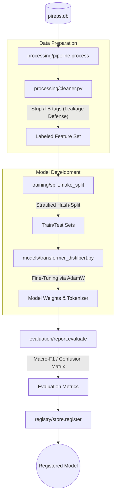

# Model Fine-Tuning Architecture

This document details the architectural process used to transform a general-purpose language model into a specialized turbulence severity classifier for aviation Pilot Reports (PIREPs).

## 1. Overview

The primary goal of the fine-tuning process is to adapt `distilbert-base-uncased` to understand the specific linguistic patterns, shorthand notations, and domain-specific terminology used by pilots in PIREPs. The resulting model is a 4-class classifier that maps cleaned report text to severity levels: `None`, `Light`, `Moderate`, and `Severe`.

## 2. Architectural Pipeline

The following diagram illustrates the end-to-end lifecycle of a model version, from raw data extraction to registry persistence.

## 3. Step-by-Step Technical Breakdown

### Step 1: Data Pipeline & Leakage Defense
The most critical risk in this pipeline is **Label Leakage**. PIREPs contain structured tags like `/TB` (Turbulence) which are the source of the ground-truth labels. If these tags remain in the text, the model will learn to simply detect the tag rather than understanding the actual description of the turbulence.

*   **Mechanism**: `processing\cleaner.py` uses a regex-based scrubbing process to remove all metadata tags and their associated values.
*   **Outcome**: The model is forced to learn from the natural language remarks (e.g., "choppy air" or "severe shaking") rather than formatting markers.

### Step 2: Dataset Split
To ensure fair comparison between the transformer and the baseline Scikit-learn models, the project uses a deterministic splitting strategy in `training\split.py`.

*   **Hash-based Splitting**: A hash of the report's unique attributes is used to assign it to a split. This ensures that as the dataset grows, existing samples do not migrate between train and test sets.
*   **Stratification**: The split is stratified by the severity label, ensuring that rare classes (like `Severe`) are represented proportionally in both the training and evaluation sets.

### Step 3: Fine-Tuning Mechanism
The `TransformerDistilbert` class implements a full fine-tuning loop using the HuggingFace `transformers` library.

*   **Base Model**: Starts with the `distilbert-base-uncased` checkpoint.
*   **Classification Head**: The pre-training head is replaced with a linear layer mapping to 4 output classes.
*   **Optimization**: 
    *   **Optimizer**: `AdamW` is used for weight decay and regularization.
    *   **Training**: The model undergoes several epochs of training, calculating Cross-Entropy loss between predictions and ground-truth labels.
*   **Persistence**: A `chopcast_manifest.txt` is saved alongside the weights to store the class mappings, ensuring the model is always loaded with the correct label IDs.

### Step 4: Aviation-Specific Tokenization
Aviation reports have a unique structure: critical context (Location/Time) is at the start, and the most important severity remarks are often at the very end. Standard truncation (cutting off the end) would lose the most predictive text.

*   **The `head_tail` Strategy**: In `models\transformer_distilbert.py`, the tokenizer is configured to keep a fixed number of tokens from the beginning of the report and a fixed number from the end, effectively "sandwiching" the content and discarding the verbose middle if it exceeds the `max_length`.

### Step 5: Inference & Evaluation
Once trained, the model's performance is validated using metrics that account for class imbalance.

*   **Loading**: The model is reconstructed from the registry using the manifest to restore the original tokenization settings and class labels.
*   **Metrics**:
    *   **Macro-F1 Score**: The primary metric, which treats each class equally regardless of how many samples it has.
    *   **Confusion Matrix**: Used to analyze where the model confuses adjacent severity levels (e.g., Moderate vs. Severe).

## 4. Configuration Summary

The model behavior is controlled by Pydantic configurations defined in `config.py`.

| Config Class | Parameter | Operational Impact |
| :--- | :--- | :--- |
| `TransformerTextConfig` | `model_name` | The base checkpoint used (e.g., `distilbert-base-uncased`) |
| `TransformerTextConfig` | `max_length` | The total token budget per report |
| `TransformerTextConfig` | `truncation` | Strategy used (`head`, `tail`, or `head_tail`) |
| `TransformerTrainConfig` | `learning_rate` | The step size for AdamW updates |
| `TransformerTrainConfig` | `epochs` | Number of times the model sees the full training set |
| `TransformerTrainConfig` | `batch_size` | Number of reports processed per gradient update |
